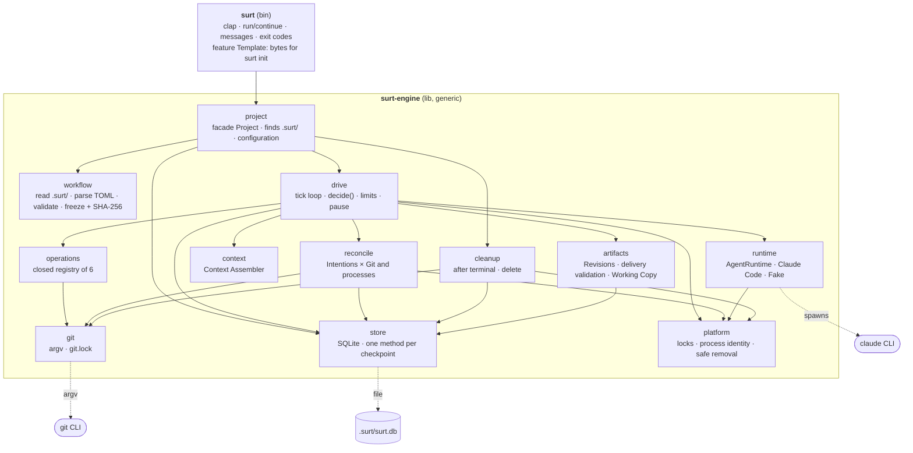
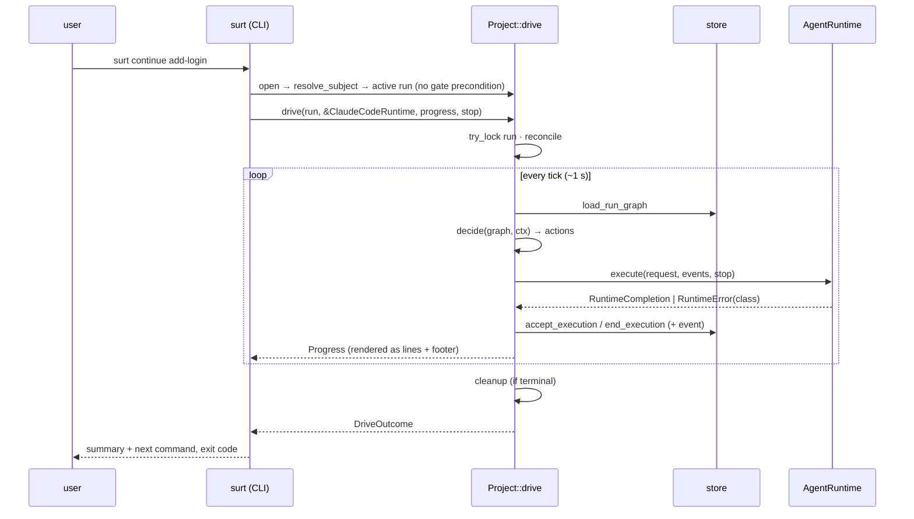

# A. Overview

Part of section A (Architecture): the parts of Surt and how they depend on each other. The other parts of section A are [Process Model and Concurrency](A-process-model.md) and [Git Integration](A-git-integration.md). Crates, module contracts and traits are specified in [B. Rust Workspace, Modules and Traits](B-workspace.md). Vocabulary is defined in [`CONTEXT.md`](../../CONTEXT.md).

## Components

- Arrows are compile-time dependencies. Only `project` is visible to the CLI.
- `runtime` is the only module behind a trait ([B](B-workspace.md#traits)). `git`, `store` and `platform` talk to the real tool, database and OS, in production and in tests.
- Nothing in `surt-engine` knows the feature workflow, and neither does the CLI. Every Workflow Definition and Agent is a project file under `.surt/workflows/` and `.surt/agents/`, read and frozen when a root run is created; the CLI only holds the feature Template's bytes, which `Project::init` writes on `surt init --template feature` ([ADR 0013](../adr/0013-definitions-live-in-the-project.md)).

## One driving command, end to end

