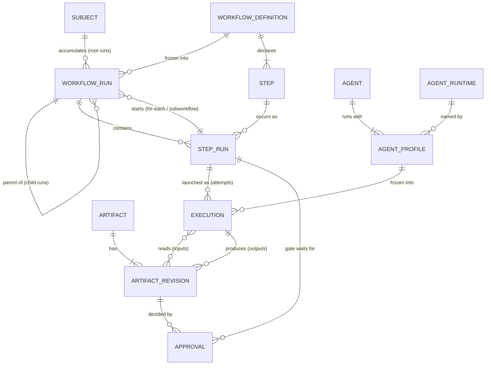

# C. Domain Model

Conceptual entities, relationships and invariants, independent of physical tables. Vocabulary is defined in [`CONTEXT.md`](../../CONTEXT.md); this section adds structure and rules. The physical schema (section D) must serve this model, not the other way around.

## Two layers

| Layer | Knows about | Must not know about |
|---|---|---|
| **Engine** | Workflow Definition, Workflow Run, Child Workflow Run, Subject, Step, Step Run, Execution, Iteration, Attempt, Approval Gate, Approval, Agent, Agent Profile, Agent Runtime, Native Operation, Artifact, Artifact Revision | Feature, Task, Spec Agent, Task Agent, Builder, Reviewer, Shipper |
| **Built-in feature workflow** | Feature (its Subject), Task (items of its manifest Artifact), Task Cycle (its child Workflow Definition), its five Agents | — |

The feature workflow is expressed entirely in engine terms: a Feature is a Subject, a Task is an item a for-each step expands over, and each Task Cycle is a Child Workflow Run.

## Relationships



Reading notes:

- A **Subject** groups root Workflow Runs over time; Child Workflow Runs belong to it through their root.
- A **Step Run** of a for-each or subworkflow step starts Child Workflow Runs and finishes only when they all reach a terminal state.
- An **Execution** uses either one Agent Profile (frozen at launch) or one Native Operation.
- An **Approval Gate** is a Step Run with zero Executions; it completes when an Approval on the expected Artifact Revision is recorded.
- An **Artifact Revision** has exactly one origin: one Execution (as output) or one human edit.

## Invariants

1. **Frozen definition.** A Workflow Run freezes its effective Workflow Definition at creation and never rereads it.
2. **One active run per Subject.** A Subject has at most one non-terminal root Workflow Run at a time. Different Subjects run concurrently with no domain-level limit (the per-project limit on concurrent agents belongs to the process model — [A. Process Model and Concurrency](A-process-model.md)).
3. **Finished Step Runs are never reopened.** Repeating work because of a decision (e.g. a rejected review) is a new **Iteration**, which creates new Step Runs. Repeating work because of a technical failure is a new **Attempt**, which is a new Execution of the same Step Run.
4. **One running Execution per Step Run.**
5. **Immutable, single-origin Revisions.** Artifact Revisions are never mutated, and an Approval never carries over to a newer Revision.
6. **Engine is workflow-agnostic.** No engine concept, rule or storage is specific to Feature, Task or any feature-workflow Agent.

## Worked example

Feature `20261015-add-login`, three Tasks, Task B on its second Iteration:

```
Subject 20261015-add-login
└─ Workflow Run #1  (feature)                 RUNNING
   ├─ spec            DONE        Execution 1 → spec rev 1
   ├─ approve-spec    DONE        0 Executions; Approval on spec rev 1
   ├─ plan-tasks      DONE        Execution 1 → task manifest rev 1 (A, B, C)
   ├─ implement       RUNNING     for-each over the manifest
   │  ├─ Child Run #2 (task-cycle, A)   DONE
   │  ├─ Child Run #3 (task-cycle, B)   RUNNING   iteration 2
   │  │  ├─ build  #1   DONE      1 Execution
   │  │  ├─ review #1   DONE      → changes requested; feedback rev 1
   │  │  ├─ build  #2   DONE      2 Executions (crash, then success): 2 Attempts
   │  │  └─ review #2   RUNNING
   │  └─ Child Run #4 (task-cycle, C)   PENDING   waits for B
   └─ ship            PENDING
```

## Decided elsewhere

- States and transitions of runs, Step Runs and Executions: section G ([Máquina de estados do loop Builder ↔ Reviewer](../../.scratch/surt-architecture/issues/10-loop-builder-reviewer.md)).
- Iteration and Attempt limits, and Agent Profile escalation between Iterations: same ticket.
- Where Revisions live, freezing and revalidation after edits: section H ([Armazenamento de artefatos, congelamento e revalidação](../../.scratch/surt-architecture/issues/08-armazenamento-congelamento-revalidacao.md)).
- Physical tables: section D ([Schema SQLite](../../.scratch/surt-architecture/issues/11-schema-sqlite.md)).

Decision record: [ADR 0001 — Task Cycle runs as a Child Workflow Run](../adr/0001-task-cycle-as-child-workflow-run.md).
