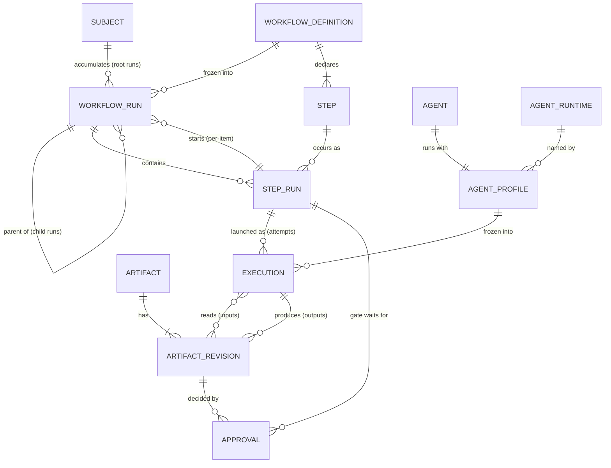

# C. Domain Model

Conceptual entities, relationships and invariants, independent of physical tables. Vocabulary is defined in [`CONTEXT.md`](../../CONTEXT.md); this section adds structure and rules. The physical schema ([D. Database Schema](D-database.md)) must serve this model, not the other way around.

## Two layers

| Layer | Knows about | Must not know about |
|---|---|---|
| **Engine** | Workflow Definition, Workflow Run, Child Workflow Run, Subject, Step, Step Run, Execution, Iteration, Attempt, Approval Gate, Approval, Input Step, Agent, Agent Profile, Conversation, Agent Runtime, Operation, Artifact, Artifact Revision | Feature, Task, Spec Agent, Task Agent, Builder, Reviewer, Shipper |
| **The feature Template** (project files under `.surt/`) | Feature (its Subject), Task (items of its manifest Artifact), Task Cycle (its child Workflow Definition), its five Agents | — |

The feature workflow is expressed entirely in engine terms: a Feature is a Subject, a Task is an item of an Item List a Per-Item Step expands over, and each Task Cycle is a Child Workflow Run.

## Relationships



Reading notes:

- A **Subject** groups root Workflow Runs over time; Child Workflow Runs belong to it through their root.
- A **Step Run** of a Per-Item Step starts one Child Workflow Run per item of an Item List and finishes only when they all reach a terminal state. A Per-Item Step is the only way to start a Child Workflow Run.
- An **Execution** uses either its Agent's single Agent Profile, taken from the root Workflow Run's frozen agent definitions and recorded at launch, or one Operation. An agent Execution has its own session id; when its Agent keeps a **Conversation**, it continues the one of the last successful Execution of the same step in the same Loop ([F](F-agent-contract.md#a-conversation-across-a-loop)). Contracts, instructions and effective profiles are frozen at root run creation; see [F. Agent Contract](F-agent-contract.md).
- An **Approval Gate** is a Step Run with zero Executions; it completes when an Approval (approve or reject) on the latest Revision of its Artifact is recorded, with Outcome `approved` or `rejected`.
- An **Input Step** is a Step Run with zero Executions too; it completes when the answers to the latest Revision of its `questions` Artifact are recorded, with Outcome `answered`, as a new human-origin Revision of its answers Artifact.
- An **Artifact Revision** has exactly one origin: one Execution (as output) or one human edit. The Run Inputs given to `surt run`, the reason given to `surt reject` and the answers given to `surt answer` are human-origin Revisions. A Child Workflow Run's item is not a new Revision: it is one item inside an existing Item List Revision.
- An **Item List Revision** contains its JSON and any named files referenced by its items. Approval covers the complete content. A child sees only its own item's files, pinned to that Revision; materializing them as inputs creates no new Revision. The feature Template's Task Agent uses this generic mechanism for one Markdown document per Task; see [F. Agent Contract](F-agent-contract.md).

## Invariants

1. **Frozen definition.** A Workflow Run freezes its effective Workflow Definition at creation and never rereads it.
2. **One active run per Subject.** A Subject has at most one non-terminal root Workflow Run at a time. Different Subjects run concurrently with no domain-level limit (the per-project limit on concurrent agents belongs to the process model — [A. Process Model and Concurrency](A-process-model.md)).
3. **Finished Step Runs are never reopened.** Repeating work because of a decision (e.g. a rejected review) is a new **Iteration**, which creates new Step Runs. Repeating work because of a technical failure is a new **Attempt**, which is a new Execution of the same Step Run.
4. **One running Execution per Step Run.**
5. **Immutable, single-origin Revisions.** Artifact Revisions are never mutated, and an Approval never carries over to a newer Revision.
6. **Engine is workflow-agnostic.** No engine concept, rule or storage is specific to Feature, Task or any feature-workflow Agent.
7. **Pinned after consumption.** Once an approved Revision is read as an Input, no human edit to its Artifact is recorded for the rest of the Workflow Run ([H](H-artifact-storage.md#revalidation)).

## Worked example

Feature `20261015-add-login`, three Tasks, Task B on its second Iteration:

```
Subject 20261015-add-login
└─ Workflow Run #1  (feature)                 RUNNING
   ├─ spec            DONE        Execution 1 → spec rev 1
   ├─ approve-spec    DONE        0 Executions; Approval on spec rev 1
   ├─ plan-tasks      DONE        Execution 1 → task manifest rev 1 (A, B, C)
   ├─ implement       RUNNING     per_item over the manifest
   │  ├─ Child Run #2 (task-cycle, A)   DONE
   │  ├─ Child Run #3 (task-cycle, B)   RUNNING   iteration 2
   │  │  ├─ build  #1   DONE      1 Execution
   │  │  ├─ review #1   DONE      → changes requested; feedback rev 1
   │  │  ├─ build  #2   DONE      2 Executions (crash, then success): 2 Attempts
   │  │  └─ review #2   RUNNING
   │  └─ Child Run #4 (task-cycle, C)   PENDING   waits for B
   └─ ship            PENDING
```

## Decided elsewhere

- States and transitions of runs, Step Runs and Executions, and the Iteration and Attempt limits: [G. State Machines](G-state-machines.md).
- Where Revisions live, Working Copies, edit detection, pinning and revalidation: [H. Artifact Storage, Freezing and Revalidation](H-artifact-storage.md).
- Physical tables: [D. Database Schema](D-database.md).

Decision record: [ADR 0001 — Task Cycle runs as a Child Workflow Run](../adr/0001-task-cycle-as-child-workflow-run.md).
