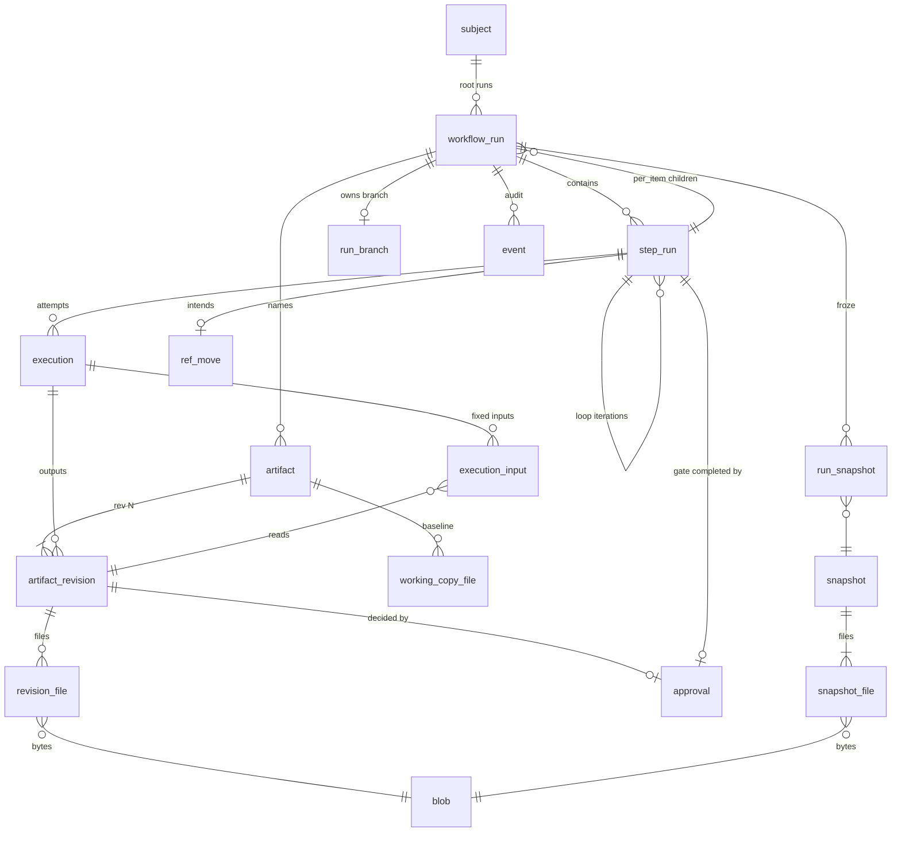

# D. Database Schema

The physical SQLite schema behind [C. Domain Model](C-domain-model.md). SQLite is the source of truth for every Workflow Run. Vocabulary is defined in [`CONTEXT.md`](../../CONTEXT.md). Decision ticket: [SQLite schema](../../.scratch/surt-architecture/issues/11-sqlite-schema.md).

The complete initial migration is [`migrations/0001_initial.sql`](migrations/0001_initial.sql). It runs in `sqlite3` 3.46+ (the range sqlx 0.9 bundles). In Milestone 1 it moves to the crate's `migrations/` directory unchanged. It carries no comments, following the project's comment rule ([`rules/clean-code.md`](../../rules/clean-code.md)); a tool directive such as sqlx's `-- no-transaction` is the only exception. This section explains it; the SQL file is the authority on columns.

## Conventions

| Thing | Representation | Why |
|---|---|---|
| Table names | singular, `snake_case` (`step_run`, `artifact_revision`) | — |
| Primary keys | UUIDv7 as `TEXT`, lowercase hyphenated, generated by Rust | The id in `.surt/runtime/executions/<id>/`, in `locks/<root-run-id>.lock` and in the database is the same string, so it can be copied into `sqlite3`. `BLOB(16)` would show `X'0192F3…'`. A deliberate exception to the project's `INTEGER PRIMARY KEY` preference: see [Rule exceptions](#rule-exceptions). |
| Event order | `event.seq INTEGER PRIMARY KEY` | UUIDv7 order is only guaranteed inside one process; the audit log needs one global order. A rowid is always greater than every existing one; it can only repeat the number of a row a purge removed, which nothing references. `AUTOINCREMENT` would add the `sqlite_sequence` table for a guarantee no reader needs. |
| Timestamps | `INTEGER`: UTC Unix seconds | Compared and sorted as numbers. Always written by Rust. No column uses `DEFAULT CURRENT_TIMESTAMP`, which writes text. Seconds are enough: order inside a second comes from `event.seq`, `attempt` or `number`, and Git dates commits in seconds. In `sqlite3`, `datetime(created_at, 'unixepoch')` shows them. |
| Hashes | lowercase hex SHA-256 `TEXT`, `CHECK (length(…) = 64)` | Same form as in `status` and in the artifact storage design. |
| Tables | all `STRICT` | Type affinity cannot silently store a string in an integer column. |
| Soft delete | none: no table has `deleted_at` | See [Deleting history](#deleting-history). |

## Opening the database

Under `.surt/runtime/locks/db.lock` ([A. Process Model](A-process-model.md#opening-the-database)), every process configures its connection before running migrations:

```sql
PRAGMA journal_mode = WAL;     -- persistent in the file; set at creation, verified on every open
PRAGMA synchronous = FULL;     -- fsync on every commit
PRAGMA foreign_keys = ON;      -- sqlx default
PRAGMA busy_timeout = 5000;    -- sqlx default
```

- The process that creates `surt.db` switches it to WAL while holding `db.lock`, so two processes never race on the first switch. It also inserts the single `project` row with the new `project_id`.
- `synchronous = FULL` rather than `NORMAL`: with `NORMAL`, a power cut in WAL mode can undo the last committed transaction. Surt records an intention, then acts on Git or the filesystem. Losing that record after the effect happened would leave recovery with an effect it has no record of. Surt commits a few transactions per second at most, so the extra fsync does not matter.
- Every write transaction uses `BEGIN IMMEDIATE` and retries on `SQLITE_BUSY` by matching the error code (sqlx reports it as `ErrorKind::Other`).

## Tables



| Table | Holds | Domain concept |
|---|---|---|
| `project` | one row: `project_id` (`<dir-slug>-<6hex>`, the primary key), created with the database; the trigger `project_single_row` refuses a second row | — ([A. Git Integration](A-git-integration.md)) |
| `blob` | content-addressed bytes | storage for Revisions and snapshots ([H](H-artifact-storage.md)) |
| `snapshot`, `snapshot_file` | frozen Workflow Definitions, Agents (contract + instructions + schemas + single profile) and project config, each as files with an identity hash | freezing ([E](E-workflow-schema.md#freezing-and-identity), [F](F-agent-contract.md)) |
| `run_snapshot` | which snapshots a root run froze | the frozen closure |
| `subject` | unique name | Subject |
| `workflow_run` | root and child runs | Workflow Run, Child Workflow Run |
| `step_run` | one row per Step occurrence, per Iteration | Step Run, Iteration |
| `execution` | one row per launch | Execution, Attempt |
| `artifact` | a name inside one Workflow Run | Artifact |
| `artifact_revision`, `revision_file` | immutable versions and their files | Artifact Revision, Pinned Revision |
| `approval` | approve or reject decisions | Approval |
| `working_copy_file` | baseline hash per Working Copy file | Working Copy |
| `execution_input` | Revisions fixed as Inputs when an Execution starts | Input |
| `run_branch` | the branch a run's Operations created, its tip and worktree | Integration Branch, Task Branch |
| `ref_move` | a ref move an Operation is about to make | Intention ([I](I-recovery.md#intentions)) |
| `event` | append-only audit log | — |

The brief's seven tables changed as follows. `step_dependencies` does not exist: `needs`, Loop bodies and `when` live in the frozen Workflow Definition, which is immutable, and the scheduler reads them from there. Copying them into rows would store the same truth twice. `execution_artifacts` with an input/output role became `execution_input`, because an output is already the single origin of its Revision (`artifact_revision.execution_id`).

No table, column or value names Feature, Task, Spec, Builder, Reviewer or Shipper. `run_branch` belongs to the Git Operations, which are part of Surt's Operation registry. It describes "the branch a run's setup created", which is true of both root and child runs.

### Workflow Runs

- A root run has `root_run_id = id`. A child has its root's id and `parent_step_run_id` (the `per_item` Step Run that started it) plus `item_key`. CHECKs make these columns consistent: a root has an `ordinal` and a `config_sha256`, a child has neither, and only a root has a cancel or stop request or a Driver identity. These columns stay on `workflow_run` rather than in a separate root table, because the partial unique index `one_active_root_per_subject` needs `subject_id` and `state` in the same table.
- `ordinal` numbers root runs within their Subject (1, 2, …). It gives the Integration Branch suffix `.N` from the second run on.
- `state` stores only `active`, `succeeded` and `cancelled`. `RUNNING`, `AWAITING APPROVAL`, `BLOCKED` and `INTERRUPTED` are derived on read ([G](G-state-machines.md#workflow-run)).
- `cancel_requested_at` / `cancel_requested_by` are the pending request written by `surt cancel`. `stop_requested_at` / `stop_requested_by` are the pending Interruption request written by `surt stop` ([J](J-cli.md#stop-and-cancel)); a driving command clears it when it takes the run lock, because it addresses only the Driver that was live when it was written. `driver_pid`, `driver_start_time` (native), `driver_boot_id` and `driver_since` identify the last Driver for display and recovery. The run lock decides ownership, never these columns ([ADR 0002](../adr/0002-file-locks-over-sqlite-leases.md)).
- `cleaned_at` (root only, terminal only) is written when the cleanup of a terminal run finishes. A terminal root run whose policy calls for a cleanup and whose `cleaned_at` is NULL is cleanup pending; the next command that takes its lock finishes it ([I. Cleanup](I-cleanup.md#when-cleanup-runs)).

### Step Runs

- `step_key` is the step id in the frozen definition and `kind` is copied from it for queries. The engine validates `step_key` against the definition. There is no `step` table.
- A Step Run inside a Loop body has `loop_step_run_id` (its Loop's Step Run) and `iteration`. Uniqueness: one Step Run per `(workflow_run_id, step_key)` outside Loops, one per `(loop_step_run_id, iteration, step_key)` inside them.
- `started_at` is the first time the Step Run became `running` and never changes. `git.integrate` uses it as the fixed author and committer date of its merge commit, so every Attempt recomputes the same SHA ([A. Git Integration](A-git-integration.md#integration)).
- `budget_base` measures the budget of [G. Limits](G-state-machines.md#limits). For `agent` and `operation` Step Runs it is the number of `failed` Executions that are not `transient`, and for a `loop` the number of Iterations, counted when the Step Run last became `running`. A Step Run blocks when `count − budget_base` reaches the limit. Unblocking sets `budget_base` to the current count. It is integer arithmetic and never depends on the clock:
  ```
  build B iter 2   blocked (attempts_exhausted)   budget_base 0   failed attempts 1, 2, 3
  $ surt start …   running                        budget_base 3   → attempt 4
  ```
- `blocked_reason` is `attempts_exhausted`, `not_retryable` or `iterations_exhausted`. The detail that `status` prints comes from the last Execution's `error_message`, not from a copy on the Step Run.

### Executions

- `attempt` numbers Executions within their Step Run; `(step_run_id, attempt)` is unique. The partial unique index `one_live_execution_per_step_run` enforces at most one `queued` or `running` Execution per Step Run (invariant 4).
- An agent Execution references its Agent's frozen snapshot (`agent_snapshot_sha256`). An Operation Execution references its `operation_id`. Only agent Executions can be `queued` or hold a `slot`.
- A `failed` Execution has a `failure_class` (`retryable`, `not_retryable` or `transient`), which the Agent Runtime or Operation sets. A `transient` failure does not count toward the Attempt limit ([I](I-recovery.md#transient-failures-network-and-rate-limits)). `error_code` and `error_message` are its diagnosis.
- `pid`, `process_start_time` and `process_boot_id` identify the process tree so recovery can stop an orphan without mistaking a reused pid ([A. Process Model](A-process-model.md#orphaned-agents)). An Operation that spawns a long-running tree (a Check) records that tree's identity in the same columns while it runs.
- `runtime_info` is JSON: Claude Code version, session id, reported model, requested effort, exit code, turn count, usage, cost, permission denials. It is what `inspect` shows when the log files are gone ([I. Cleanup](I-cleanup.md#logs)). Unknown values are absent, never zero ([F](F-agent-contract.md)). The keys are `runtime_version`, `session_id`, `model` (as the runtime reported it), `effort` (as Surt requested it), `exit_code` (absent when Surt stopped the process), `turns`, `usage` (the reported `input_tokens`, `output_tokens`, `cache_creation_input_tokens`, `cache_read_input_tokens`), `cost_usd`, `permission_denials` (the reported array, each entry cut to `tool_name` and `tool_use_id`; the tool input is never stored) and, for a transient failure, `resets_at`. The runtime reports them once, when its process ends, whether or not a result event arrived; the Fake reports `session_id`, `model` and `exit_code`.

### Artifacts, Revisions and Approvals

- An Artifact is a name inside one Workflow Run (`UNIQUE (workflow_run_id, name)`). A child resolves `pass` names in its parent run and `item` in the parent's Item List Revision.
- A Revision has `number` (the `rev N` users see) and `identity_sha256` over its sorted `(rel_path, sha256)` pairs. Its origin is exactly one of an Execution (`execution_id`) or a human action: `initial` (an Initial Artifact such as `request` or `base`), `edit` (a Working Copy edit) or `rejection_reason` (the `-m` of `surt reject`). An Execution outputs at most one Revision per Artifact.
- `revision_file.rel_path` is checked to be relative, `/`-separated and free of `.`, `..` and empty segments. The full portable-name rules are validated in Rust ([A. Git Integration](A-git-integration.md#item-keys-and-item-file-paths)).
- `pinned_at` marks a Pinned Revision. It is set in the same transaction that pins: the one fixing the first Input that reads the approved Revision, or the one expanding a Per-Item Step over it. Expansion pins before any child Execution exists, so pinning cannot be derived from `execution_input`. The cause is recorded as a `revision.pinned` event.
- `approval` has one row per decision. `UNIQUE (revision_id)`: a Revision is decided at most once. A rejected Revision is never approved later, because rejection starts a new Iteration that produces a new Revision.
  - `gate_step_run_id` is the Approval Gate Step Run the decision completed. Each gate Step Run is completed by one decision.
  - `gate_step_run_id` is `NULL` for a **revalidation approval**: `surt approve` on a newer Revision of an artifact whose gate already passed ([H](H-artifact-storage.md#revalidation)). It completes no step; it only lets the next driving command proceed. A revalidation decision is always `approve`.
  - `reject` requires `reason_revision_id`, the human-origin Revision of the gate's `rejection_artifact`.
  - `identity_sha256` copies the Revision identity. Readers compare it with the Revision.
- `actor` (on human-origin Revisions and Approvals), `cancel_requested_by` and `stop_requested_by` hold the repository's `git config user.email`, or the OS user name when no email is configured. They are informative; no rule depends on them.
- `working_copy_file` stores, per Working Copy file, the SHA-256 Surt last wrote and the Revision it came from: the baseline that edit detection compares with. `pending_sha256` / `pending_revision_id` are the Intention of a newer Revision published but not yet written to the file; they are promoted to the baseline once the file is written ([I](I-recovery.md#working-copy-files)).
- `execution_input` stores each Input as fixed at start: the name the agent or Operation reads, the Revision, and for `item` the item's key in the Item List Revision. Materializing these files creates no Revision.

### Snapshots

A snapshot is a set of files with an identity hash, shared by every run that froze identical content: 30 Features built with the built-in `feature.toml` store it once. `kind` is:

| `kind` | Files | Identity |
|---|---|---|
| `workflow` | the canonical definition | SHA-256 of the canonical form ([E](E-workflow-schema.md#freezing-and-identity)) |
| `agent` | effective `agent.toml`, instructions and every local schema it references | as in [F](F-agent-contract.md) |
| `config` | the effective project configuration frozen at root run creation: `[[checks]]`, `max_attempts`, `max_iterations`, `[git] merge_into_base`, the effective `[cleanup] on_success` ([I](I-cleanup.md#when-cleanup-runs)) and any per-run override | SHA-256 of its canonical form |

`run_snapshot` lists what a root run froze. `workflow_run.definition_sha256`, `workflow_run.config_sha256` and `execution.agent_snapshot_sha256` point at snapshots. The engine guarantees they belong to their root's `run_snapshot` set; a foreign key cannot express that.

### Git state

`run_branch` has at most one row per Workflow Run: the branch its setup Operation created. The row is written **before** the branch, as its Intention, so recovery can tell a branch Surt meant to create from someone else's.

```
root run       ref refs/heads/surt/20261017-add-login              start = Base             tip = M_B
child run (B)  ref refs/heads/surt/task/20261017-add-login/B       start = tip when B began
               worktree /Users/…/.surt/worktrees/surt-a1b2c3/20261017-add-login/B
               merged_as M_B
```

- `tip_sha` is the last tip Surt recorded. `git.integrate` uses it as `T` in its compare-and-swap, and any ref that differs from it is an external move ([A. Git Integration](A-git-integration.md#ownership-of-the-integration-branch)). For a run with a worktree, accepting an Execution that ran there records the branch's tip as `tip_sha` in the publication transaction; every Attempt starts from a worktree reset to it ([I](I-recovery.md#preparing-a-worktree-for-every-attempt)).
- `worktree_path` is absolute and recorded when the worktree is created. Surt never recomputes it.
- `merged_as_sha` is the merge commit that integrated the branch. `git.snapshot_run_branch` and `status` read it.
- `ref_name` is unique, so two runs can never claim the same branch.

`ref_move` holds at most one pending ref move per Step Run (`git.integrate`, `git.merge_into_base`): `ref_name`, `old_sha`, `new_sha`, and `worktree_path` when the move is a checkout in that worktree. It is committed before the move and deleted with the confirmation. Recovery compares the ref with it: `new_sha` → confirm, `old_sha` → redo, anything else → stop ([I](I-recovery.md#ref-moves)). The Base branch is not a `run_branch`, so the Intention cannot be a column there.

### Events

`event` is an audit log. Every state change writes its event **in the same transaction**. The engine never reads `event` to decide anything: state lives in the other tables. A missing event would make a timeline incomplete, never change behaviour.

```
$ surt inspect 20261017-add-login B
14:02:11  step.running        build iter 2
14:02:11  execution.started   attempt 1 (agent-0)
14:09:40  execution.failed    attempt 1 · invalid_delivery
14:31:02  step.blocked        attempts_exhausted
16:10:00  step.unblocked      budget_base 3
```

- `kind` is an open set, not a CHECK, so a new kind needs no table rebuild. Initial kinds: `run.created`, `run.cancel_requested`, `run.stop_requested`, `run.cancelled`, `run.succeeded`, `driver.started`, `driver.stopped`, `driver.recovered`, `intention.confirmed`, `intention.discarded`, `worktree.salvaged`, `worktree.repaired`, `agents.paused`, `agents.resumed`, `iteration.started`, `step.running`, `step.done`, `step.skipped`, `step.blocked`, `step.unblocked`, `step.cancelled`, `execution.queued`, `execution.started`, `execution.succeeded`, `execution.failed`, `execution.interrupted`, `execution.cancelled`, `execution.orphan_stopped`, `revision.published`, `revision.pinned`, `working_copy.edit_detected`, `working_copy.edit_refused`, `working_copy.restored`, `working_copy.written`, `ref_move.intended`, `approval.recorded`, `cleanup.finished`, `cleanup.incomplete`.
- A trigger aborts any `UPDATE`. Rows leave only with their Subject.
- Every insert goes through one store helper that takes the kind and its `data`.

#### Event data

`data` holds display details only, written with the event. A timeline renders from it without joins. The engine never reads it to decide anything; `status` only shows the last `cleanup.*` event's lists. A missing field, or the `{}` of a Milestone 1 event, renders as the bare kind. Kinds not listed carry `{}`.

| Kind | `data` |
|---|---|
| `run.created` | root run: `base` (the `base` Initial Artifact's JSON, e.g. `{"ref", "sha"}`), `actor`; child run: `item` |
| `run.cancel_requested`, `run.stop_requested` | `actor` |
| `driver.started`, `driver.stopped` | `pid`. `driver.stopped` is written on every Driver exit that returns normally after `driver.started`; a crash or a kill writes none |
| `driver.recovered` | `previous_pid`, `found`: one object per finding, each with `kind`, `step`, `item`, `iteration` plus `attempt` and `pid` (`orphan_stopped`), `attempt` (`discarded`, `interrupted_with_driver`), `branch` and `merge` (`integration_recorded`), `attempt` and `code` (`attempt_failed`). Written only when reconciliation found something |
| `ref_move.intended`, `intention.confirmed`, `intention.discarded` for a ref move | `intention` = `ref_move`, `ref`, `old_sha`, `new_sha`. Confirmed when the Operation's result deletes the row, discarded when the row is deleted because the move did not happen or happened elsewhere |
| `intention.confirmed`, `intention.discarded` for a run's branch | `intention` = `run_branch`, `ref`, `sha` (the recorded tip), `found` (the ref's SHA before settling, `null` when absent), `worktree` for a child run. Written when an Attempt finds the `run_branch` row an earlier Attempt recorded: confirmed when the branch (and worktree) is now in place, discarded when it is not |
| `iteration.started` | `iteration`, `cause`: `loop_started` for the first, else `until_not_met` with the `until` `step` and its `outcome` in the previous Iteration |
| `step.done` | `outcome` |
| `step.blocked` | `reason` |
| `step.unblocked` | `budget_base`, the new budget base |
| `execution.started` | `attempt`, and `slot` and `runtime` (`claude-code`, `fake`) for an agent or `operation` for an Operation |
| `execution.succeeded` | `outcome` |
| `execution.failed` | `code`, `message` |
| `execution.orphan_stopped` | `pid` |
| `agents.paused` | on the root run, once an agent waits for the pause and again whenever its end moves later: `until` (Unix seconds), `code` (the error code of the failure that set `until`), `backoff_step` (1 for the first step; absent when the reset time came from the stream), `waiting` (agent Step Runs ready to launch) |
| `agents.resumed` | on the root run: `paused_seconds`, from the first `agents.paused` of the pause to the resume |
| `worktree.repaired` | `path`, `repair` |
| `worktree.salvaged` | `ref`, the Salvage Ref |
| `revision.published` | `artifact`, `revision` (its number), `origin` = `execution` |
| `working_copy.edit_detected` | `artifact`, `revision`, `origin` = `human`, `actor` |
| `working_copy.edit_refused` | `artifact`, `files`, `reason`: `pinned` with `revision`, or `invalid` with `problem` |
| `working_copy.restored` | `artifact`, `revision` restored, and the paths it rewrote: `changed`, `new` (removed), `missing` (recreated) |
| `approval.recorded` | `decision` (`approve`, `reject`), `artifact`, `revision`, `actor`, `reason` (first line of a rejection's reason, else `null`) |
| `cleanup.finished`, `cleanup.incomplete` | `kept`, and `left` when incomplete |

## When rows are created

Rows are created eagerly, in the transaction that makes them knowable, so `status` can list what waits and why:

| Rows | Created | In the same transaction |
|---|---|---|
| `subject`, root `workflow_run`, `run_snapshot`, Initial Artifacts (`request`, `base`) | when the creating command makes the root run | every top-level Step Run of the definition, all `pending` |
| Step Runs of a Loop body | when an Iteration starts | every step of the body for that Iteration, all `pending` |
| Child `workflow_run`s | when a Per-Item Step expands | one per item, all at once, each with its top-level Step Runs `pending`; the Item List Revision is pinned |
| `execution` | when the Driver launches the work | its `execution_input` rows |
| `artifact` | with its first Revision | the Revision, its files and blobs |

A run therefore shows `C ⏸ pending — waits for B` from the moment the manifest expands, because Task C's child run and its `setup` Step Run already exist. No `artifact` row exists for a name that never had content, such as `manifest-rejection-reason` when the manifest was approved on the first try.

## What may be JSON

| May be JSON | Never JSON |
|---|---|
| `execution.runtime_info` (display and diagnosis) | states, Outcomes, foreign keys, Inputs, Approvals, ordinals, counters |
| `event.data` (event details) | anything the engine reads to choose its next step |
| — | artifact content: it is bytes in `blob`, even for a `.json` artifact |

Both JSON columns have `CHECK (json_valid(…))`.

## Invariants and where they are enforced

| Invariant ([C](C-domain-model.md#invariants)) | Enforced by |
|---|---|
| 1. Frozen definition | `definition_sha256` / `config_sha256` / `agent_snapshot_sha256` point at immutable snapshots; nothing updates `snapshot_file` |
| 2. One active run per Subject | partial unique index `one_active_root_per_subject` |
| 3. Finished Step Runs never reopened | engine (a `done`/`skipped`/`cancelled` row is never updated); uniqueness per Iteration makes a new Iteration a new row |
| 4. One running Execution per Step Run | partial unique index `one_live_execution_per_step_run` |
| 5. Immutable, single-origin Revisions | origin CHECKs; engine never updates a Revision except `pinned_at`; one decision per Revision (`UNIQUE (revision_id)` on `approval`) |
| 6. Engine is workflow-agnostic | no workflow-specific table, column or value |
| 7. Pinned after consumption | `pinned_at`, set in the pinning transaction |

## Deleting history

No table has `deleted_at`. Removing a Subject's history is a **purge**: one transaction that runs `DELETE FROM subject WHERE id = ?`, then deletes snapshots no `run_snapshot` references and blobs no `revision_file` or `snapshot_file` references.

- Composition foreign keys are `ON DELETE CASCADE`: subject → runs → Step Runs → Executions, run → artifacts → Revisions → files, Approvals, baselines, inputs, branch row, events, and snapshot → its files.
- Cross-references (input → Revision, reject → reason Revision, files → blob, anything → snapshot) are `NO ACTION`, not `RESTRICT`. `NO ACTION` is checked at the end of the statement, after the cascade has removed both sides. `RESTRICT` would fail in the middle of the cascade.
- A purge is `surt delete`: Git and disk first, this transaction last, so an interrupted delete is finished by running it again ([I. Cleanup](I-cleanup.md#surt-delete)). Rationale: [ADR 0009](../adr/0009-history-is-purged-not-soft-deleted.md).

## Example reads

Blocked steps of a run with the error to print (the `status` mock in [G](G-state-machines.md#workflow-run)):

```sql
SELECT coalesce(w.item_key, '(root)') AS item, s.step_key, s.iteration, s.blocked_reason, e.error_message
FROM step_run s
JOIN workflow_run w ON w.id = s.workflow_run_id
LEFT JOIN execution e ON e.id = (
  SELECT id FROM execution WHERE step_run_id = s.id ORDER BY attempt DESC LIMIT 1)
WHERE w.root_run_id = ?1 AND s.state = 'blocked';
```

Latest Revision of an artifact, its decision and whether it is pinned (revalidation):

```sql
SELECT r.number, a.decision, r.pinned_at IS NOT NULL AS pinned
FROM artifact_revision r
LEFT JOIN approval a ON a.revision_id = r.id
WHERE r.artifact_id = ?1
ORDER BY r.number DESC LIMIT 1;
```

Live work the scheduler looks at uses `step_run_by_run (workflow_run_id, state)` and `live_execution`. Every foreign key column used by a cascade has an index.

## Queries and migrations in code

- Queries use `sqlx::query_as::<_, T>` with `FromRow` at runtime. There are no `query!` macros, no `.sqlx` directory and no `DATABASE_URL` at build time. Every query is exercised by a test against a real file database.
- Migrations are embedded with `sqlx::migrate!` and run only while holding `db.lock`.
- `.gitattributes` forces `*.sql text eol=lf`, because sqlx checksums the bytes and CRLF would make a checkout on Windows look like an edited migration.
- A released migration is never edited; changes are new migrations, additive where possible. A table rebuild uses `-- no-transaction` with `PRAGMA foreign_keys = OFF` around it, followed by `PRAGMA foreign_key_check`.
- A database newer than the binary is refused with the message of [A. Process Model](A-process-model.md#opening-the-database), mapped from sqlx's `VersionMissing`, not passed through raw.

## Rule exceptions

Deviations from [`rules/sqlite.md`](../../rules/sqlite.md), in the rules' report format:

```
Exceptions: INTEGER PRIMARY KEY; 0001_initial.sql:*.id; ids name files, lock files and directories outside the database and are generated before the row exists; TEXT keys are larger and index slower than rowids
```

- **Why not rowids:** an id is chosen in Rust before its row is committed and names things outside SQLite (`runtime/executions/<id>/`, `locks/<root-run-id>.lock`). A rowid is only known after the insert, and after a purge SQLite may reuse it, so a leftover directory or lock file of a deleted run could be taken for a new one. UUIDv7 never repeats.
- **Cost accepted:** each key is 36 bytes instead of up to 8, and every foreign key index is larger. A project holds thousands of rows, not millions; [measurement](#example-reads) decides if this ever matters.
- `event.seq` stays a rowid: nothing outside the database names an event.

## Not reserved

External providers (GitHub, Linear, Jira) get no column yet. A column with no format and no reader invites inconsistent use. When a provider exists, its reference is an additive migration.

## Decided elsewhere

- States, transitions and limits these columns hold: [G. State Machines](G-state-machines.md).
- What a Revision is, Working Copy and pinning rules: [H. Artifact Storage](H-artifact-storage.md).
- Ownership by file locks, Driver identity, slots: [A. Process Model](A-process-model.md).
- Reconciling these rows with Git and processes after a crash: [I. Recovery and Reconciliation](I-recovery.md).
- When cleanup and purge run: [I. Cleanup, Delete and Logs](I-cleanup.md).
- Commands, output formats and exit codes that read these rows: [J. CLI Surface](J-cli.md).
- The `store` module and its interface: [B. Rust Workspace](B-workspace.md#the-store-interface).

Decision record: [ADR 0009 — History is purged, not soft-deleted](../adr/0009-history-is-purged-not-soft-deleted.md).
