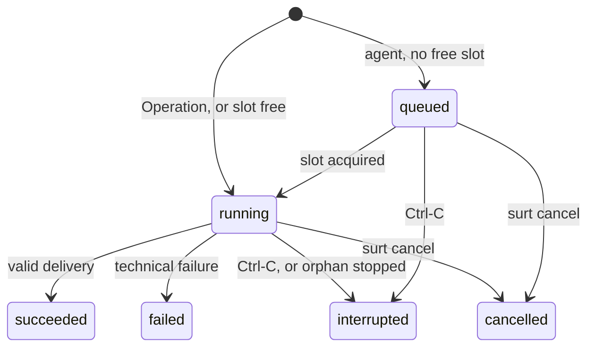
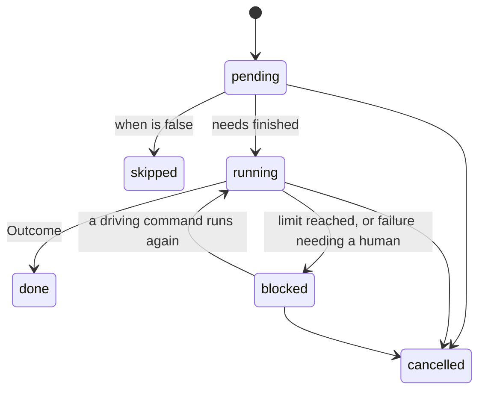

# G. State Machines

States and transitions of Executions, Step Runs and Workflow Runs, the Attempt and Iteration limits, and how the feature Template's Task Cycle uses them. Vocabulary (**Execution**, **Step Run**, **Iteration**, **Attempt**, **Blocked**, **Interruption**, **Cancellation**) is defined in [`CONTEXT.md`](../../CONTEXT.md); entities and invariants are in [C. Domain Model](C-domain-model.md). Decision ticket: [Builder ↔ Reviewer loop state machine](../../.scratch/surt-architecture/issues/10-builder-reviewer-loop.md).

Recovery after a crash (what an orphan or a second Ctrl-C leaves behind, partial Operations) is [I. Recovery and Reconciliation](I-recovery.md). This section only names the states recovery moves between.

## Execution

One launch of work: an agent session or an Operation.



| State | Meaning | Counts toward the Attempt limit |
|---|---|---|
| `queued` | An agent Execution waiting for an agent slot ([A. Process Model](A-process-model.md#agent-concurrency-limit)). Operations never queue. | — |
| `running` | Its process or Operation is live. | — |
| `succeeded` | Accepted delivery, with the Outcome it declared. `changes_requested` is a success. | no |
| `failed` | Technical failure: invalid or missing delivery, crash, non-zero exit, configured turn or cost limit reached, launch error ([F](F-agent-contract.md#runtime-success-and-failure)). Its `failure_class` is `retryable`, `not_retryable` or `transient`. | **yes**, except `transient` |
| `interrupted` | Stopped by an Interruption, or found `queued`/`running` with no live Driver by the next one, which stops the process if it survived (an orphan, [A](A-process-model.md#orphaned-agents)). Nothing it produced is accepted, even a valid delivery whose end the Driver never recorded ([I](I-recovery.md#principles)). | no |
| `cancelled` | Stopped because its root Workflow Run was cancelled. | no |

All states except `queued` and `running` are final. An Execution is never resumed or adopted: work continues as a new Execution of the same Step Run, which is a new **Attempt**. An Agent with `conversation = "loop"` continues, in its new Execution, the conversation of its last `succeeded` Execution in the same Loop, never that of an `interrupted`, `failed` or `cancelled` one; a continuation that cannot be resumed restarts fresh inside the same Execution and spends no Attempt ([F](F-agent-contract.md#a-conversation-across-a-loop)).

Interruptions and orphans do not count because the agent did not cause them. A developer who presses Ctrl-C five times never exhausts a step.

## Step Run

One occurrence of a step in one Iteration of a Workflow Run.



| State | Meaning |
|---|---|
| `pending` | Some step it `needs` has not finished. |
| `running` | In progress. What that means depends on the kind (below). |
| `done` | Finished with an Outcome. |
| `skipped` | Its `when` was false. It satisfies `needs` like a finished step ([E](E-workflow-schema.md#step-kinds)). |
| `blocked` | It cannot go on without a human: a limit was reached or a failure cannot be fixed by retrying ([Limits](#limits)). Not final. |
| `cancelled` | Its root Workflow Run was cancelled. |

`done`, `skipped` and `cancelled` are final. A final Step Run is never reopened (invariant 3 of [C](C-domain-model.md#invariants)). `blocked` is **not** final, so leaving it does not reopen anything: the same Step Run continues with new Attempts or Iterations.

`running` per kind:

| Kind | While `running` | Ends `done` when |
|---|---|---|
| `agent`, `operation` | It has at most one `queued`/`running` Execution. Between Attempts (after a `failed` or `interrupted` one) it has none. | an Execution `succeeded` |
| `approval` | It has no Execution; it waits for `surt approve` / `surt reject`. `status` shows it as awaiting approval. | an Approval is recorded |
| `input` | It has no Execution; it waits for `surt answer`. `status` shows it as awaiting an answer, with its questions' artifact and round. | the answers are recorded (Outcome `answered`) |
| `loop` | Its current Iteration's Step Runs are in progress. | `until` matches ([E](E-workflow-schema.md#loops)) |
| `per_item` | Its Child Workflow Runs are in progress. | every child `succeeded` ([Per-Item Steps](#per-item-steps-and-blocked-children)) |

Only `agent`, `operation` and `loop` Step Runs can become `blocked`. An Approval Gate and an input step wait for a human by design and have no limit. Recording the answers closes the input step `done`/`answered`, publishes the answers Revision and writes `answer.recorded` and `step.done` in one transaction, as an Approval does for a gate.

## Workflow Run

A Workflow Run stores only its lifecycle:

| Stored state | Meaning |
|---|---|
| `active` | Not finished. |
| `succeeded` | Its final steps finished. |
| `cancelled` | Ended by a Cancellation. |

Next to it, a root run stores a **cancel request** (when, by whom) written by `surt cancel` while a Driver is live ([A](A-process-model.md#external-control)). It is a pending request, not a state. The Driver turns it into `cancelled` on its next tick. A **stop request** written by `surt stop` works the same way but ends in an Interruption, not a state change of the run ([J](J-cli.md#stop-and-cancel)).

**There is no `failed` Workflow Run.** Every failure stops at a `blocked` Step Run, which a human can resume. A run ends only by succeeding or by being cancelled. Rationale: [ADR 0008](../adr/0008-limits-block-instead-of-failing.md).

What `surt status` shows for an `active` run is **derived** from its Step Runs on every read, never stored, so it cannot drift from them:

| Shown | Derived when |
|---|---|
| `RUNNING` | a Driver holds the run lock |
| `AWAITING APPROVAL` | no Driver, and some Approval Gate is `running` |
| `AWAITING ANSWER` | no Driver, and some input step is `running` |
| `BLOCKED` | no Driver, and some Step Run is `blocked` |
| `INTERRUPTED` | no Driver, and work that could run without a human remains |

A run can be both awaiting approval and blocked in a generic workflow with parallel branches; `status` lists both. The feature workflow never shows both, because its gates come before `implement`.

```
$ surt status 20261017-add-login
20261017-add-login   BLOCKED   (no driver)
  implement
    A  ✔ merged          iter 1
    B  ⛔ blocked         iter 2 · build: 3 attempts failed — invalid delivery JSON
    C  ⏸ pending         waits for B
    D  ✔ merged          iter 2
  fix: inspect B, then rerun  surt continue 20261017-add-login
```

A Child Workflow Run follows the same rules. Its derived state is what `status` shows per Task.

### When a Driver returns

`drive(root_run_id)` ([A](A-process-model.md#driving-a-run)) returns when nothing can run without a human: every non-final Step Run is a `running` Approval Gate or input step, is `blocked`, or waits (`pending`) behind one of them. The driving command then exits. It exits successfully when it reached an Approval Gate or an input step (`DriveOutcome::AtGate`, each `Gate` with its `kind`, `approval` or `input`) or the run succeeded. It exits with an error when it stopped on `blocked`, printing each blocked step with its last error and the command to resume. Exit codes: `0` and `4` respectively ([J. Exit codes](J-cli.md#exit-codes)).

### Cancellation

A Cancellation stops every `queued`/`running` Execution of the root run and its children (they become `cancelled`), marks every non-final Step Run `cancelled`, marks every `active` Child Workflow Run `cancelled`, and finally the root run. It is one state change per row inside the cancel transaction, after the processes are stopped.

## Limits

Two limits stop work that would otherwise repeat without a human watching. Both are project configuration, frozen when the root Workflow Run is created, like `[[checks]]` ([A. Git Integration](A-git-integration.md#checks)). They are the top-level keys `max_attempts` and `max_iterations` of `.surt/config.toml` ([J. Configuration](J-cli.md#configuration)).

| Key | Default | Applies to | Counts |
|---|---|---|---|
| `max_attempts` | `3` | every `agent` and `operation` Step Run | its `failed` Executions, except Transient Failures |
| `max_iterations` | `5` | every `loop` Step Run whose body contains no `approval` or `input` step | its Iterations |

### Attempts

- A Step Run whose Execution `failed` starts a new Attempt at once, with the same frozen Agent Profile ([F](F-agent-contract.md#agent-profile)).
- When the number of `failed` Executions since the Step Run last became `running`, not counting Transient Failures, reaches `max_attempts`, the Step Run becomes `blocked` instead.
- **Failures that retrying cannot fix block on the first occurrence**, without using the remaining Attempts. The Agent Runtime or the Operation classifies them. The initial set is:
  - auth failure, unavailable or mismatched model, unsupported settings;
  - launch errors: missing executable, incompatible CLI, missing Git Bash on Windows;
  - an Integration Branch whose tip moved outside Surt, or that is checked out in a worktree ([A. Git Integration](A-git-integration.md#ownership-of-the-integration-branch));
  - API errors retrying cannot fix: `authentication_failed`, `billing_error`, `model_not_found`, `invalid_request`;
  - a worktree path that belongs to something Surt did not create, and an interrupted fast-forward into the Base in the user's worktree ([I](I-recovery.md#an-interrupted-fast-forward-into-the-base)).
- **Transient Failures** (rate limit, overload, server or network errors) spend no Attempt and never block. The Execution is `failed` with `failure_class = 'transient'`, the Step Run stays `running`, and the Driver pauses every agent launch until the latest reported reset time or the next backoff step (1, 2, 4, 8, then 15 minutes) ends, then starts a new Attempt. Operations keep running meanwhile, and there is no ceiling ([I](I-recovery.md#transient-failures-network-and-rate-limits)).

```
✖ item B build attempt 1: invalid delivery — final JSON missing "outputs"
↻ item B build attempt 2
✖ item B build attempt 2: invalid delivery — commit 3e1f… does not descend from start
↻ item B build attempt 3
✖ item B build attempt 3: invalid delivery — final JSON missing "outputs"
⛔ item B build blocked after 3 failed attempts
```

### Iterations

- Every Iteration of a Loop counts, whatever ended the previous one. The engine does not know why `until` was not met. In the Task Cycle a rejected review, a failed Check and an integration conflict each cost one Iteration.
- When a Loop's Iteration ends without matching `until` and the Loop already ran `max_iterations` Iterations since it last became `running`, it does not start another. The Loop Step Run becomes `blocked`.
- **A Loop whose body contains an `approval` or an `input` step has no limit.** A human already decides every Iteration of it, as in `spec-loop` and `tasks-loop`. This is a static property of the definition, not knowledge of any workflow.

```
B  iter 5/5 · review ✖ changes_requested (2 blocking findings)
⛔ item B blocked: 5 iterations without merge
```

### Leaving `blocked`

A driving command that takes a root run's lock moves every `blocked` Step Run of that run and its children back to `running`, with a **fresh budget**: `max_attempts` more failed Attempts, or `max_iterations` more Iterations. The counters keep their history (the next build is `attempt 4`, the next Iteration is `iter 6`); only the budget is measured from the moment it became `running` again. Running the command is the human decision: the developer looked at `status`, possibly fixed the cause (renewed a login, freed a branch) and chose to go on. The alternative is `surt cancel`.

```
$ surt continue 20261017-add-login
↻ unblocking item B build (3 more attempts)
↻ item B build attempt 4
```

## Per-Item Steps and blocked children

- A Child Workflow Run whose Step Run is `blocked` is shown as blocked. It is not final.
- Items that `need` it stay `pending`: they do not start, and they are not skipped or cancelled. They wait for it to finish.
- Items that do not depend on it keep running, so one stuck Task does not stop independent work.
- The Per-Item Step stays `running` until every child is final.
- Children are never cancelled one by one. In v1 a Child Workflow Run ends only as `succeeded`, or as `cancelled` together with its root. A Per-Item Step is therefore `done` only when **every** child succeeded. In the feature workflow, the Shipper never delivers a Feature with Tasks missing.

Cancelling or abandoning a single Task, with dependents skipped and a partial delivery, is out of scope for this plan.

## The Task Cycle

How the feature Template's `task-cycle` ([E](E-workflow-schema.md#task-cycletoml)) moves through these states. The engine sees only steps, Outcomes and Iterations. The rest is the Template's Agent instructions and the delivery checks their outputs declare.

| Iteration ends with | Next | What the next Builder reads |
|---|---|---|
| `check` = `failed` (`review`, `integrate` skipped) | new Iteration | `check-report` |
| `review` = `changes_requested` (`integrate` skipped) | new Iteration | `feedback` |
| `integrate` = `conflict` | new Iteration | `conflict` |
| `integrate` = `merged` | Loop `done`, child run `succeeded` | — |

Each new Iteration creates new `build`, `check`, `review` and `integrate` Step Runs. Within one of them, technical failures are Attempts. The Context Assembler labels each Input with the Iteration and step that produced it and states why the Iteration started ([F](F-agent-contract.md#instructions-and-assembled-context)).

```
B  iter 1  build ✔ (attempt 1)       check ✔  review ✖ changes_requested  integrate –
B  iter 2  build ✔ (attempts 1, 2)   check ✖  review –                    integrate –
B  iter 3  build ✔                   check ✔  review ✔ approved           integrate ✖ conflict (merge)
B  iter 4  build ✔                   check ✔  review ✔ approved           integrate ✔ merged
```

### A Builder with nothing to change

There is no "no changes" Outcome. A Builder delivery without a new commit stays an invalid delivery and costs an Attempt ([A. Git Integration](A-git-integration.md#evidence-for-a-builders-commit)).

When the Builder finds that the Task is already satisfied at its start, for example because an earlier Task already did it, its instructions tell it to make an **empty commit** (`git commit --allow-empty`) whose message says why. That is a new SHA, so it passes the delivery check. The Checks run on it. The Reviewer's instructions say an empty commit is acceptable only when the Task is verifiably satisfied, and the Reviewer judges that claim like any other change. `git.integrate` then merges it as usual. Every integrated Task still has a reviewed SHA.

### What the Reviewer reads after the first Iteration

Each Reviewer Execution is a new session with no memory. Besides `item`, `spec`, `commit` and `check-report`, it reads two optional Inputs ([F](F-agent-contract.md#effective-agenttoml)):

- `feedback?`: its own latest verdict. From the second review on, its instructions say to verify each earlier blocking finding, and to raise a new blocking finding only for code that changed since then or for a real defect that was missed. It does not move the bar between Iterations.
- `conflict?`: present after an integration conflict. `conflict.reviewed_commit` is the commit approved before and is an ancestor of the new commit. The instructions say to focus on `git diff <reviewed_commit>..<commit>`, the merge resolution and its interaction with the Tasks merged since. Code already approved is reopened only where the resolution touched it.

**The verdict always covers the whole commit.** `feedback.reviewed_commit` must equal `commit.sha` ([A. Git Integration](A-git-integration.md#binding-a-review-to-a-sha)). There is no partial or delta approval. The focus is only an instruction to the Reviewer, not a rule the engine knows.

An invalid Reviewer delivery (missing JSON, `approved` with a blocking finding, a `reviewed_commit` for another SHA) is a technical failure and costs an Attempt of that `review` Step Run, like any other agent.

## Decided elsewhere

- What an orphan or a second Ctrl-C leaves behind, partial Operations, worktree preparation before every Attempt, and which network and rate-limit errors wait instead of failing: [I. Recovery and Reconciliation](I-recovery.md).
- Columns for these states, the cancel request, Attempt and Iteration counters and budgets: [D. Database Schema](D-database.md).
- `status` layout, exit codes, and how each command refers to an existing run: [J. CLI Surface](J-cli.md).
- Agent Profile (one per Agent, no escalation): [F. Agent Contract](F-agent-contract.md#agent-profile).

Decision record: [ADR 0008 — Exhausted limits block a run instead of failing it](../adr/0008-limits-block-instead-of-failing.md).
